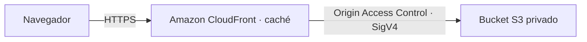

# Amazon CloudFront: configuración verificable

Sitio estático distribuido por **Amazon CloudFront**, con HTTPS, caché en los puntos de presencia y un origen **Amazon S3 privado**. La infraestructura se crea con AWS CloudFormation; no necesitas comprar un dominio ni solicitar un certificado.

El flujo principal valida la configuración **sin cuenta AWS ni creación de recursos** y genera un informe para presentar. El despliegue queda como una opción para comprobar el servicio real.

> La validación comprueba la plantilla y las reglas de seguridad, origen y caché. Una distribución atendiendo peticiones reales solo se puede comprobar con recursos activos en AWS; no se presentan pruebas locales como evidencia de ese funcionamiento.



## Contenido del repositorio

- `infra/cloudfront.yaml`: distribución, origen privado, políticas de caché y cabeceras de seguridad.
- `site/`: página de demostración; muestra las cabeceras de una petición real desde el navegador.
- `scripts/validate.py`: ejecuta las comprobaciones y genera un informe sin desplegar.
- `tests/test_infrastructure.py`: comprueba la configuración de S3 privado, OAC, HTTPS, caché y permisos.
- `scripts/deploy.sh`: crea o actualiza la infraestructura, publica el sitio, invalida la caché y verifica el resultado.
- `scripts/verify.py`: comprueba HTTPS, CloudFront, caché, versión publicada y denegación del acceso directo a S3.
- `.github/workflows/`: validación automática y despliegue manual con identidad AWS por OIDC.

## Evidenciar la configuración sin desplegar

En **GitHub → Actions → Validate CloudFront**, abre la ejecución del commit que vas a presentar. Comprueba que esté en verde y descarga el artefacto `cloudfront-configuration-…`. Incluye:

- `configuration-validation.json`: estado, commit, hash de la plantilla y resultado de cada comprobación.
- `configuration-validation.log`: salida completa de CloudFormation lint y de las pruebas.

Las comprobaciones verifican que:

1. La plantilla cumple el esquema de CloudFormation y sus referencias son válidas.
2. El bucket bloquea todo acceso público y permite lecturas únicamente al servicio CloudFront de esta distribución.
3. El origen usa S3 privado con solicitudes firmadas mediante OAC.
4. El comportamiento redirige a HTTPS, permite solo lecturas y enlaza una política de caché con TTL efectivos.
5. La política del bucket deniega el transporte inseguro.
6. El verificador y el panel rechazan respuestas incorrectas y no muestran éxitos cuando falta CloudFront. Estas últimas pruebas utilizan respuestas de prueba identificadas como tales.

Para la exposición, muestra `infra/cloudfront.yaml`, el diagrama, la ejecución verde y el informe del mismo commit. Explica su alcance como **configuración validada**, sin afirmar que se probó una distribución activa. La aceptación de esta evidencia depende del criterio del profesor; si solicita respuestas HTTP reales o un acierto de caché real, usa el despliegue opcional.

También puedes generar el informe en tu equipo con los comandos de «Validación local». No necesitas claves AWS. El workflow de despliegue permanece manual y no se ejecuta al validar.

## Desplegar desde AWS CloudShell (opcional)

Abre **AWS CloudShell** en una cuenta que permita crear recursos. Tiene AWS CLI, Python y credenciales de tu sesión. Una cuenta de AWS Academy/Learner Lab puede restringir CloudFront; el laboratorio debe estar activo y sus permisos deben permitir este servicio.

```bash
git clone https://github.com/Jonaikercortez-gif/Amazon-CloudFront.git
cd Amazon-CloudFront
bash scripts/deploy.sh
```

Estos comandos suponen que los archivos ya están integrados en `main`. Mientras estén en la rama `codex/cloudfront-demo`, agrega `--branch codex/cloudfront-demo` al comando `git clone`. Para un checkout existente, actualízalo sin descartar cambios propios. También puedes ejecutar el script en este entorno cuando tenga una identidad AWS conectada, o en tu equipo con AWS CLI autenticado. No guardes credenciales en el repositorio.

Valores predeterminados: región `us-east-1`, stack `amazon-cloudfront-demo`, `PriceClass_100`. Para cambiarlos:

```bash
AWS_REGION=us-east-1 STACK_NAME=mi-demo-cloudfront bash scripts/deploy.sh
```

Se necesitan permisos de CloudFormation (crear/actualizar/describir stacks y change sets), S3 (crear/configurar el bucket y publicar objetos), y CloudFront (distribución, OAC, políticas e invalidaciones), además de `sts:GetCallerIdentity`. No se crean usuarios ni roles IAM. El despliegue puede tardar varios minutos y **puede generar cargos AWS** por recursos, solicitudes y transferencia. `PriceClass_100` limita las ubicaciones utilizadas; no garantiza coste cero.

Al terminar, el script imprime una URL real `https://….cloudfront.net`, y guarda:

- `evidence/outputs.json`: identificadores y endpoints del stack.
- `evidence/verification.json`: resultado de las comprobaciones, fecha UTC, identificador de despliegue y cabeceras recibidas.

El directorio `evidence/` se ignora en Git. Revisa sus identificadores antes de compartirlo. Cada despliegue actualiza estos archivos; conserva una copia si necesitas evidencias de una ejecución anterior.

## Evidencias del servicio activo en AWS (opcional)

1. Abre la URL impresa y captura la página con su dominio y el panel de comprobación.
2. En **CloudFront → Distributions**, captura la distribución con estado `Deployed`, su dominio, origen S3 y OAC.
3. En las herramientas de desarrollo del navegador, captura una respuesta con `X-Cache`, `Via`, `X-Amz-Cf-Pop` y `X-Amz-Cf-Id`. Tras repetir la petición al mismo punto de presencia, el verificador exige `Hit from cloudfront`.
4. Adjunta `verification.json`: debe indicar `status: passed`, redirección HTTP a HTTPS, contenido esperado y acceso directo al objeto de S3 con HTTP 403. El informe vincula la comprobación con el identificador del despliegue y el commit local, cuando existe.

Para repetir la verificación sin desplegar:

```bash
python3 scripts/verify.py --outputs evidence/outputs.json --output evidence/verification.json
```

Si falla, el comando termina con código distinto de cero. No presentes una validación local ni un workflow de lint como evidencia de un despliegue AWS.

## Despliegue desde GitHub Actions (opcional)

El workflow **Deploy CloudFront** se ejecuta manualmente (`workflow_dispatch`) y guarda las evidencias como artefacto. No despliega en cada push.

En GitHub, crea el environment `aws-demo` y estas **variables**, sin claves estáticas:

| Variable | Valor |
| --- | --- |
| `AWS_ROLE_ARN` | ARN de un rol de tu cuenta con los permisos descritos arriba |
| `AWS_REGION` | `us-east-1`, u otra región admitida |
| `STACK_NAME` | `amazon-cloudfront-demo`, o tu nombre elegido |

Un administrador de la cuenta debe configurar el proveedor OIDC `token.actions.githubusercontent.com` (audiencia `sts.amazonaws.com`) y permitir `sts:AssumeRoleWithWebIdentity` al rol. En la relación de confianza, restringe `aud` a `sts.amazonaws.com` y `sub` exactamente a `repo:Jonaikercortez-gif/Amazon-CloudFront:environment:aws-demo`. Limita los branches permitidos en el environment a `main`. El workflow no crea esta confianza ni puede concederse permisos a sí mismo. Si tu laboratorio no permite roles OIDC, usa CloudShell con su sesión temporal.

## Validación local

No hace falta un framework ni una compilación del sitio. Para validar la plantilla y los scripts:

```bash
python3 -m venv .venv
source .venv/bin/activate
python -m pip install -r requirements-dev.txt
python scripts/validate.py
```

El informe y el log quedan en `evidence/configuration-validation.json` y `evidence/configuration-validation.log`. El comando devuelve un código distinto de cero si falla una comprobación. Usa Python 3.12 y Node.js 18 o posterior; el despliegue no necesita Node. Las pruebas **no contactan AWS**. Para visualizar solo el diseño puedes usar `python3 -m http.server 8000 --directory site`; el panel avisará que falta `deployment.json`, generado durante el despliegue.

## Eliminar los recursos de la demostración

Cuando termines, consulta los outputs del stack elegido y comprueba que corresponden a esta demostración. Los comandos siguientes **borran el contenido de ese bucket y el stack**. Ejecuta la limpieza solo cuando ya no necesites el sitio ni sus archivos:

```bash
export AWS_REGION=us-east-1
export STACK_NAME=amazon-cloudfront-demo
BUCKET_NAME=$(aws cloudformation describe-stacks --stack-name "$STACK_NAME" --region "$AWS_REGION" --query 'Stacks[0].Outputs[?OutputKey==`BucketName`].OutputValue | [0]' --output text)
test -n "$BUCKET_NAME" && test "$BUCKET_NAME" != None && aws s3 rm "s3://$BUCKET_NAME/" --recursive --region "$AWS_REGION"
aws cloudformation delete-stack --stack-name "$STACK_NAME" --region "$AWS_REGION"
aws cloudformation wait stack-delete-complete --stack-name "$STACK_NAME" --region "$AWS_REGION"
```

CloudFormation elimina también la distribución; la operación puede tardar. Confirma `DELETE_COMPLETE` o la desaparición del stack y comprueba que no queden recursos de la demo en la cuenta.
