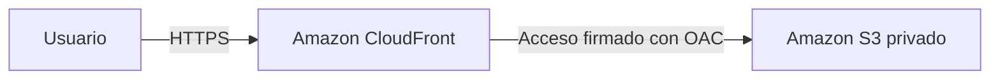

# Configuración de Amazon CloudFront con Terraform

## Objetivo de la práctica

En esta práctica preparé una configuración de Amazon CloudFront con Terraform para distribuir los archivos de una página web almacenada en Amazon S3. La idea es que los usuarios accedan al contenido por CloudFront y que el bucket de S3 se mantenga privado.

Los recursos están definidos en archivos `.tf` dentro de [infra/terraform](infra/terraform). Terraform utiliza el proveedor de AWS para crear y configurar esos recursos.

## ¿Para qué sirve CloudFront?

Amazon CloudFront es una red de distribución de contenido, también conocida como CDN. Puede guardar copias temporales de los archivos en caché y entregarlas desde su red de puntos de presencia.

El recorrido definido para este proyecto es:



## Configuración realizada

En [main.tf](infra/terraform/main.tf) se define lo siguiente:

- **Bucket de S3 privado:** almacena los archivos, bloquea el acceso público y cifra el contenido.
- **Distribución de CloudFront:** utiliza el bucket como origen y tiene `index.html` como página inicial.
- **Origin Access Control (OAC):** firma las solicitudes de CloudFront hacia S3 mediante SigV4.
- **Política del bucket:** permite la lectura al servicio CloudFront, limitada a la distribución de este proyecto.
- **HTTPS:** redirige las solicitudes HTTP a HTTPS y deniega conexiones inseguras al bucket.
- **Caché:** usa 60 segundos como valor predeterminado, con un mínimo de 0 y un máximo de 86 400 segundos.
- **Métodos de lectura:** permite `GET` y `HEAD`, con compresión y cabeceras de seguridad.
- **Archivos del sitio:** Terraform también publica el HTML, CSS, JavaScript y los metadatos del despliegue.

## Archivos del proyecto

| Archivo o carpeta | Para qué se utiliza |
| --- | --- |
| `infra/terraform/main.tf` | Define S3, CloudFront, sus políticas y los archivos publicados. |
| `infra/terraform/variables.tf` | Define región, nombre del proyecto, caché y datos de publicación. |
| `infra/terraform/outputs.tf` | Muestra el nombre del bucket y la URL del sitio. |
| `infra/terraform/versions.tf` | Fija las versiones de Terraform y del proveedor AWS. |
| `infra/terraform/.terraform.lock.hcl` | Guarda la versión y los checksums del proveedor. |
| `infra/terraform/tests/cloudfront.tftest.hcl` | Comprueba el plan con un proveedor AWS simulado. |
| `site/` | Contiene la página de ejemplo y su panel de comprobación. |
| `scripts/validate.py` | Ejecuta las comprobaciones y guarda el informe. |
| `scripts/deploy.sh` | Ejecuta Terraform y comprueba el servicio desplegado. |

La plantilla `infra/cloudfront.yaml` se conserva como referencia de la versión anterior con CloudFormation. La configuración principal y las comprobaciones actuales utilizan Terraform.

## Cómo comprobar la configuración

La validación ejecuta `terraform fmt`, `terraform init`, `terraform validate` y `terraform test`. Usa Terraform **1.17.1** y el proveedor AWS **6.71.0**, con versiones y checksums guardados en el repositorio.

Las pruebas de Terraform comprueban un plan con AWS simulado: acceso privado, OAC, HTTPS, caché, permisos y publicación del sitio. También verifican que se rechacen un nombre de proyecto incorrecto, un TTL inválido y una fecha mal formada. Estas pruebas no crean recursos en AWS.

Además, hay 9 pruebas en Python para el verificador HTTP y 4 en JavaScript para el panel. Utilizan respuestas de prueba; no son evidencia de peticiones reales a CloudFront.

### Desde GitHub

1. Entrar a **Actions → Validate CloudFront**.
2. Abrir la ejecución del commit que se quiere revisar y comprobar que termine en verde.
3. Descargar el artefacto que comienza por `cloudfront-configuration-`.

El artefacto contiene `configuration-validation.json`, con el estado y los resultados, y `configuration-validation.log`, con la salida de las herramientas y las pruebas. El resultado esperado es `"status": "passed"` y `"infrastructure_tool": "Terraform"`.

### Desde un equipo local

Se necesita Terraform 1.17.1, Python 3.12 y Node.js 18 o posterior. Terraform se puede instalar siguiendo la [guía oficial](https://developer.hashicorp.com/terraform/install). Desde la raíz del repositorio:

```bash
python3 -m venv .venv
source .venv/bin/activate
python -m pip install -r requirements-dev.txt
python scripts/validate.py
```

La primera inicialización descarga el proveedor de AWS y verifica sus checksums. La validación y las pruebas simuladas no necesitan credenciales AWS. Los resultados quedan en `evidence/`.

Para revisar solo la parte de Terraform:

```bash
terraform -chdir=infra/terraform init -backend=false -input=false -lockfile=readonly
terraform -chdir=infra/terraform fmt -check -recursive
terraform -chdir=infra/terraform validate
terraform -chdir=infra/terraform test
```

## Probar el servicio real en AWS

Para crear la infraestructura se necesita una cuenta habilitada y una sesión AWS con los permisos necesarios. Los archivos `.tf` se ejecutan con Terraform desde un equipo o terminal; no se suben a la consola de CloudFormation.

El script `bash scripts/deploy.sh` prepara los datos de publicación, ejecuta `terraform plan` y `terraform apply`, invalida la caché y comprueba la URL real. Crear recursos puede generar cargos.

Terraform guarda el estado de los recursos en `terraform.tfstate`. Ese archivo se conserva fuera de Git y se necesita para las siguientes actualizaciones y la limpieza. El despliegue opcional desde GitHub Actions exige un backend S3 para conservarlo entre ejecuciones.

Los pasos, permisos, cuidado del estado y comandos de limpieza están en la [guía de despliegue en AWS](docs/despliegue-aws.md).

## Qué demuestra esta práctica

Una validación correcta demuestra que la configuración de Terraform y las comprobaciones incluidas pasan. Para evidenciar uso real de CloudFront hay que crear la distribución y mostrar respuestas de su dominio, por ejemplo con `X-Cache: Hit from cloudfront`.

Cambiar a Terraform no resuelve una verificación de cuenta pendiente ni concede permisos AWS. La pila anterior de CloudFormation tampoco se convierte automáticamente en recursos administrados por Terraform.
