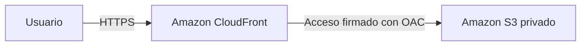

# Configuración de Amazon CloudFront

## Objetivo de la práctica

En esta práctica preparé una configuración de Amazon CloudFront para distribuir los archivos de una página web almacenada en Amazon S3. La idea es que los usuarios accedan al contenido por CloudFront y que el bucket de S3 se mantenga privado.

La configuración está escrita en una plantilla de AWS CloudFormation. Así, los recursos y sus opciones quedan guardados en este repositorio y se pueden revisar sin tener que crearlos manualmente en la consola de AWS.

## ¿Para qué sirve CloudFront?

Amazon CloudFront es una red de distribución de contenido, también conocida como CDN. Sirve para entregar archivos, como páginas, imágenes y estilos, desde puntos de presencia distribuidos en distintas ubicaciones.

CloudFront puede guardar una copia de los archivos en caché. Cuando vuelve a recibir una solicitud del mismo contenido, puede responder desde esa copia mientras siga vigente.

En este proyecto, el recorrido definido es:



## Configuración realizada

La plantilla principal está en [infra/cloudfront.yaml](infra/cloudfront.yaml). En ella se define lo siguiente:

- **Bucket de S3 privado:** almacena los archivos y bloquea el acceso público.
- **Distribución de CloudFront:** utiliza ese bucket como origen y tiene `index.html` como página de inicio.
- **Origin Access Control (OAC):** permite que CloudFront haga solicitudes firmadas al bucket.
- **Política del bucket:** permite leer los archivos al servicio CloudFront, limitado a la distribución de este proyecto.
- **HTTPS:** redirige las solicitudes HTTP a HTTPS y bloquea conexiones inseguras al bucket.
- **Caché:** usa un tiempo predeterminado de 60 segundos, con un mínimo de 0 y un máximo de 86 400 segundos.
- **Métodos de lectura:** solo permite `GET` y `HEAD` desde CloudFront.
- **Compresión y cabeceras de seguridad:** se configuran para la entrega del sitio.

## Archivos del proyecto

| Archivo o carpeta | Para qué se utiliza |
| --- | --- |
| `infra/cloudfront.yaml` | Define la infraestructura de AWS. |
| `site/` | Contiene la página de ejemplo, sus estilos y el panel de comprobación. |
| `scripts/validate.py` | Ejecuta la validación local y guarda los resultados. |
| `tests/` | Contiene las pruebas de la configuración, el verificador y el panel. |
| `.github/workflows/validate.yml` | Ejecuta la validación en GitHub Actions. |
| `scripts/deploy.sh` | Permite desplegar los recursos si se quiere probar el servicio real. |
| `scripts/verify.py` | Comprueba las respuestas de una distribución ya desplegada. |

## Cómo comprobar la configuración

Para revisar el proyecto utilicé `cfn-lint`, que comprueba la plantilla de CloudFormation, y pruebas automáticas. La validación incluye 15 pruebas en Python y 4 en JavaScript.

Entre otras cosas, se comprueba que el bucket sea privado, que el acceso esté limitado a la distribución, que se use OAC firmado y que estén configurados HTTPS y la caché. También se revisa que el verificador y el panel detecten respuestas incorrectas.

Las pruebas del verificador y del panel utilizan respuestas de prueba. No hacen solicitudes a una distribución real de AWS.

### Desde GitHub

1. Entrar a la pestaña **Actions** del repositorio.
2. Abrir **Validate CloudFront** y seleccionar la ejecución del commit que se quiere revisar.
3. Comprobar que termine en verde.
4. Descargar el artefacto que comienza por `cloudfront-configuration-`.

Ese artefacto contiene dos archivos:

- `configuration-validation.json`: muestra el estado de la validación, el commit y las comprobaciones realizadas.
- `configuration-validation.log`: contiene la salida de las herramientas y las pruebas.

El resultado esperado en el informe es `"status": "passed"`. Si una comprobación falla, la ejecución queda marcada como fallida y se puede revisar el error en el registro.

### Desde un equipo local

Se necesita Python 3.12 y Node.js 18 o posterior. Desde la carpeta del proyecto:

```bash
python3 -m venv .venv
source .venv/bin/activate
python -m pip install -r requirements-dev.txt
python scripts/validate.py
```

Los resultados se guardan en la carpeta `evidence/`, que está excluida de Git porque se genera en cada ejecución.

## Qué demuestra esta práctica

La evidencia principal es la validación de la plantilla y de las reglas definidas para CloudFront y S3. Estas comprobaciones se pueden ejecutar sin una cuenta AWS y sin crear recursos.

Esto no demuestra que haya una distribución atendiendo visitas. Para comprobar la entrega real de archivos y observar cabeceras como `X-Cache: Hit from cloudfront`, hace falta desplegar los recursos.

El repositorio también incluye esa opción. Los pasos, permisos necesarios y comandos de limpieza están en la [guía de despliegue en AWS](docs/despliegue-aws.md).
